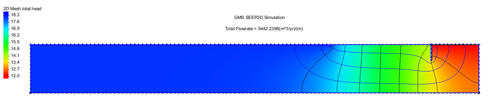
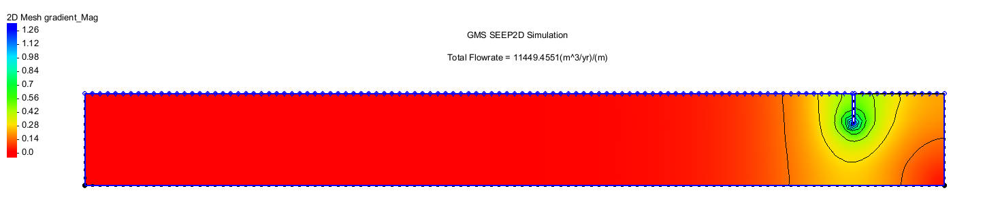
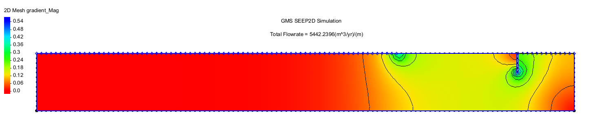

# Cofferdam seepage: assessing an upstream clay blanket

**A two-dimensional SEEP2D study of seepage control, hydraulic gradients and residual piping risk.**

[中文说明](README.zh-CN.md) · [All figures](docs/FIGURES.md) · [Model files](models/README.md) · [Results](data/scenario-results.csv)

## Engineering question

How much can an upstream clay blanket reduce seepage into a dewatered cofferdam, and where do high hydraulic gradients remain? I compared two configurations using the same cross-section and water levels: a sheet-pile cofferdam in sand, and the same cofferdam with a clay blanket.

## Model and inputs

The model was developed in GMS using SEEP2D. A symmetric half-section represents seepage through sand above impermeable bedrock. The sheet pile extends 4 m into the soil and is 0.3 m thick. Prescribed heads of 18 m outside and 12 m inside the cofferdam create a 6 m head difference.

In the second configuration, a 25 m clay blanket is represented by a no-flow boundary. This idealisation tests the effect of extending the seepage path beneath an impermeable cover.

| Setting | Baseline | Clay blanket |
|---|---|---|
| External/internal head | 18 / 12 m | 18 / 12 m |
| Sheet-pile embedment | 4 m | 4 m |
| Upstream blanket | Absent | 25 m; no-flow boundary |
| Outputs | Seepage rate, total head, hydraulic gradient | Same outputs |

## Results and interpretation

| Result | Baseline | Clay blanket |
|---|---:|---:|
| Reported seepage, m³/(year·m) | 11,149.46 | 5,442.24 |
| Maximum hydraulic gradient | 1.26 | 0.54 |

The reported seepage rate falls by approximately **51%**, while the maximum gradient falls by approximately **57%**. These are two-dimensional model results per unit width.

The blanket reduces inflow and the extent of high-gradient zones. Local concentrations remain near the sheet pile and the blanket edge. The study uses gradient thresholds of 0.17 and 0.8 to screen piping and boiling risk respectively; these are case-specific criteria. The lower maximum gradient does not by itself establish that all piping risk has been removed.

## Explore the case

The [figure gallery](docs/FIGURES.md) contains the conceptual section, boundary conditions, head/flow results and all gradient displays. The [two model archives](models/README.md) retain the GMS projects and their SEEP2D files. Different colour thresholds in the gallery are views of the same scenario results.

The analysis illustrates how seepage control can be evaluated through both discharge reduction and local gradients. A site design would also need soil-specific erosion criteria and a realistic assessment of blanket permeability and defects.

Analysis: **Tianshu Zhang**.
