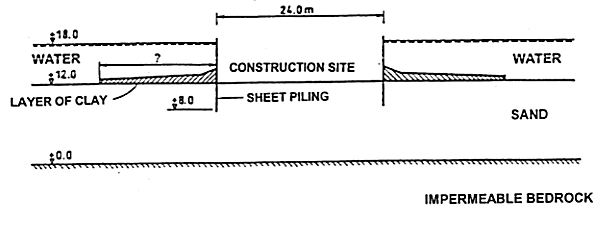
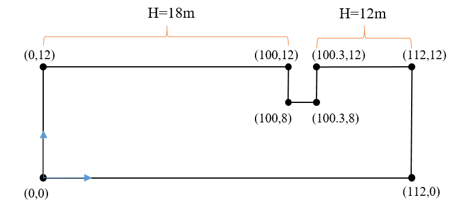
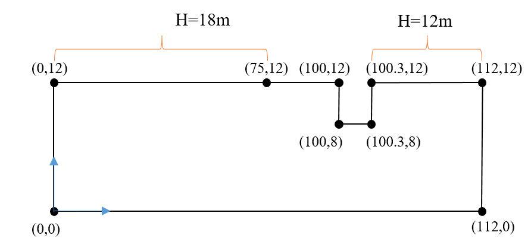
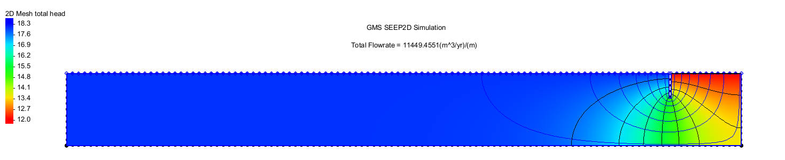
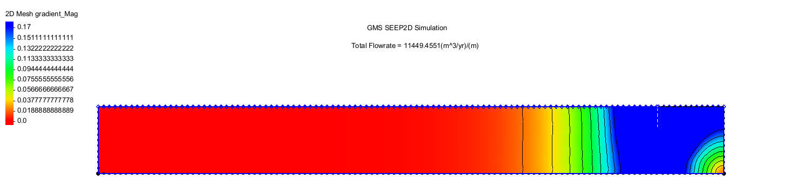
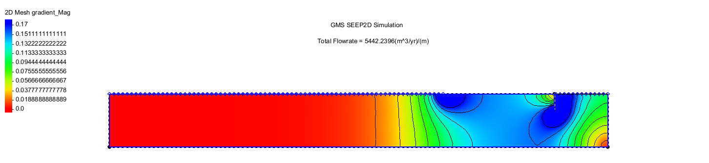
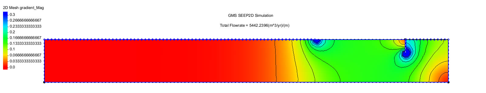
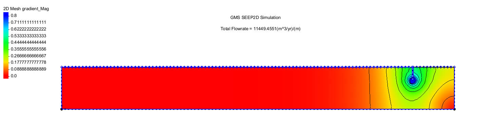
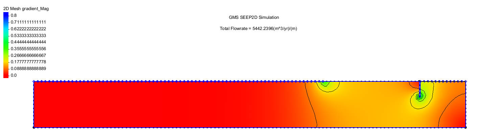

# Figures / 图集

[Project](../README.md) · [中文说明](../README.zh-CN.md)

Scientific figures extracted from the original report; display thresholds are not new simulations.

## Conceptual section

## Baseline boundary conditions

## Clay-blanket boundary conditions

## Baseline total head and flow

## Clay-blanket total head and flow

## Baseline hydraulic gradient

## Baseline gradient at 0.17 display threshold

## Clay-blanket hydraulic gradient

## Clay-blanket gradient at 0.17 display threshold

## Clay-blanket gradient at 0.3 display threshold

## Baseline gradient at 0.8 display threshold

## Clay-blanket gradient at 0.8 display threshold

